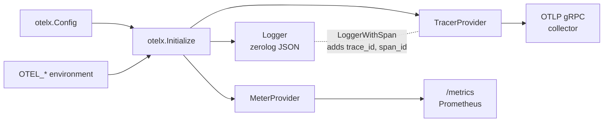

# otelx

> **Maturity Level**: Emerging - Initial development, API subject to change

otelx sets up OpenTelemetry tracing, Prometheus metrics and a trace-aware
[zerolog](https://github.com/rs/zerolog) logger for a Go service with one call.
It configures what a service needs, leaves everything else to the standard
`OTEL_*` environment variables, and hands back the real SDK providers.



## Install

```bash
go get github.com/twistingmercury/otelx/src/v2
```

The optional Gin middleware is a separate module, so services that don't use
Gin don't download it:

```bash
go get github.com/twistingmercury/otelx/src/middleware/gin/v2
```

## Usage

```go
package main

import (
    "context"
    "log"

    "github.com/twistingmercury/otelx/src/v2"
    "go.opentelemetry.io/otel"
)

func main() {
    ctx := context.Background()

    tel, err := otelx.Initialize(ctx, otelx.Config{
        ServiceName:    "my-service",
        ServiceVersion: "1.0.0",
        Environment:    "production",
        MetricsAddr:    ":9090",
        Tracing:        true,
    })
    if err != nil {
        log.Fatal(err)
    }
    defer tel.Shutdown(ctx)

    // Spans and instruments come from the global providers otelx registered.
    ctx, span := otel.Tracer("my-service").Start(ctx, "operation")
    defer span.End()

    counter, _ := otel.Meter("my-service").Int64Counter("requests")
    counter.Add(ctx, 1)

    // LoggerWithSpan adds trace_id and span_id so logs join to traces.
    logger := otelx.LoggerWithSpan(tel.Logger, ctx)
    logger.Info().Msg("handled request")
}
```

### Config

Every field is optional except `ServiceName`, and `OTEL_SERVICE_NAME` can
supply that instead.

| Field | Default | Purpose |
| --- | --- | --- |
| `ServiceName` | none | `service.name` resource attribute and `service` log field |
| `ServiceVersion` | none | `service.version` attribute and `version` log field |
| `Environment` | none | `deployment.environment.name` attribute and `environment` log field |
| `LogLevel` | `"info"` | zerolog level name: `trace`, `debug`, `info`, `warn`, `error`, `fatal`, `panic` or `disabled` |
| `LogWriter` | `os.Stdout` | Where JSON log lines go |
| `MetricsAddr` | metrics off | Listen address for the Prometheus server, such as `":9090"` or `":0"` |
| `MetricsPath` | `"/metrics"` | HTTP path for metrics |
| `Tracing` | `false` | Turns on the tracer provider |
| `TraceExporter` | OTLP gRPC | A `sdktrace.SpanExporter` to use instead of OTLP |
| `Sampler` | from `OTEL_TRACES_SAMPLER` | A `sdktrace.Sampler` that overrides the environment |

### Environment variables

otelx does not duplicate settings the OpenTelemetry SDK already reads. The
common ones:

| Variable | Effect |
| --- | --- |
| `OTEL_EXPORTER_OTLP_ENDPOINT` | Collector address, such as `http://otel-collector:4317`. An `http://` scheme also turns off TLS. Default `https://localhost:4317`. |
| `OTEL_EXPORTER_OTLP_INSECURE` | `true` turns off TLS |
| `OTEL_EXPORTER_OTLP_HEADERS` | Extra headers as URL-encoded `key=value` pairs, such as `authorization=Bearer%20token` |
| `OTEL_TRACES_SAMPLER`, `OTEL_TRACES_SAMPLER_ARG` | Sampler, such as `parentbased_traceidratio` with `0.1`. Default `parentbased_always_on`. |
| `OTEL_SERVICE_NAME` | Overrides `Config.ServiceName` |
| `OTEL_RESOURCE_ATTRIBUTES` | Extra resource attributes; they override `Config` values |

### The Telemetry struct

```go
type Telemetry struct {
    Logger         zerolog.Logger
    MeterProvider  *sdkmetric.MeterProvider // nil when metrics are off
    TracerProvider *sdktrace.TracerProvider // nil when tracing is off
}

func (t *Telemetry) Shutdown(ctx context.Context) error
func (t *Telemetry) MetricsURL() string
```

`Shutdown` flushes and stops everything and returns every failure joined with
`errors.Join`. `MetricsURL` reports the address actually bound, which matters
when `MetricsAddr` uses port 0.

### Gin middleware

```go
import ginmw "github.com/twistingmercury/otelx/src/middleware/gin/v2"

r := gin.New()
r.Use(ginmw.LoggingMiddleware(tel, ginmw.WithSkipPaths("/health")))

r.GET("/users", func(c *gin.Context) {
    logger := ginmw.Logger(c, tel)
    logger.Info().Msg("listing users")
})
```

`LoggingMiddleware` logs method, path, status, latency, client IP, response
size and trace IDs for each request. It does not log the query string, which
can carry tokens or personal data. `CorrelationMiddleware` stores the
trace-aware logger without logging requests. The middleware does not create
spans; pair it with
[otelgin](https://pkg.go.dev/go.opentelemetry.io/contrib/instrumentation/github.com/gin-gonic/gin/otelgin)
for that, as the [examples](examples/) do.

## How it works

**Logging** is a plain zerolog JSON logger tagged with the service identity.
otelx does not send logs through the OpenTelemetry logs signal. Instead,
`LoggerWithSpan` copies the current span's trace and span IDs into the log
line, so a log backend can link entries to traces.

**Metrics** use the OpenTelemetry Prometheus exporter. Each `Telemetry` gets
its own Prometheus registry and HTTP server, with Go runtime and process
metrics included. `Initialize` binds the port before returning, so a port
conflict is an error.

**Tracing** uses the OTLP gRPC exporter with a batch span processor. The
default sampler respects the parent span's decision, so traces that start
upstream stay whole.

**Resources** carry `service.name`, `service.version`,
`deployment.environment.name`, `host.name`, `process.pid` and the SDK's own
`telemetry.sdk.*` attributes, plus anything from the environment.

## Global state

`Initialize` sets these process-wide globals:

- `otel.SetTracerProvider` and `otel.SetTextMapPropagator` (W3C Trace Context
  and Baggage), when tracing is on
- `otel.SetMeterProvider`, when metrics are on

It does not change zerolog's global level or use the default Prometheus
registry. Calling `Initialize` more than once is safe, but the globals point
at the most recent call's providers.

## Upgrading from v1

The module path changed to `github.com/twistingmercury/otelx/src/v2` and
`Initialize` takes a `Config` instead of options. [CHANGELOG.md](CHANGELOG.md)
maps each v1 option to its replacement.

## Development

```bash
make unit-test   # go vet and race tests for every module
make analyze     # goimports, golangci-lint, govulncheck and gosec
make build       # the full CI check inside Docker
```

The repository holds two modules, both under `src/`: the library and the Gin
middleware in `src/middleware/gin`. `src/go.work` ties them and the examples together
for local work, and the Makefile and Docker build run each check in both
modules.

### Releasing

Tag the library first, then the middleware, because the middleware requires
the library version:

```bash
git tag src/v2.0.0
git tag src/middleware/gin/v2.0.0
git push origin src/v2.0.0 src/middleware/gin/v2.0.0
```

## License

MIT License. See [LICENSE](LICENSE) for details.
